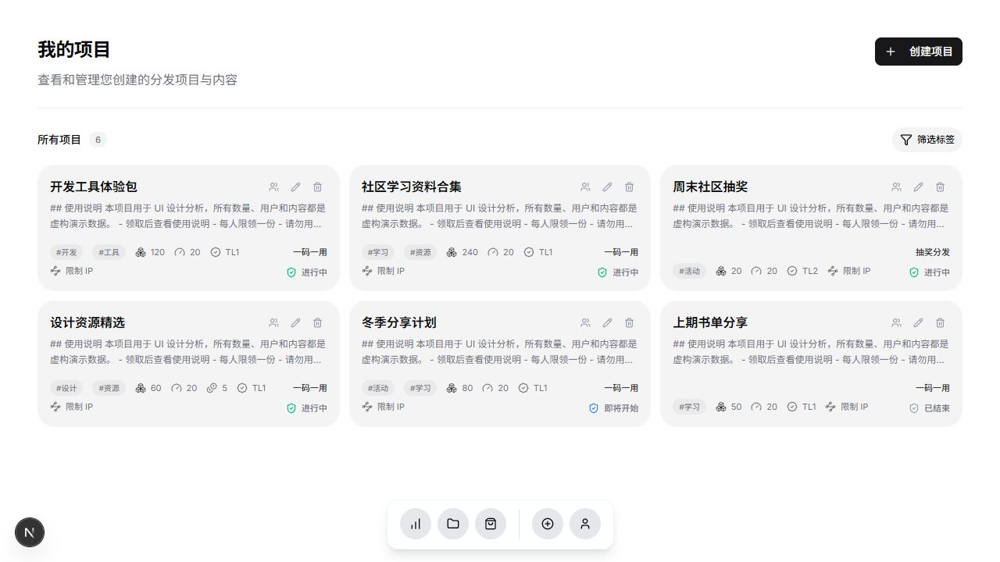
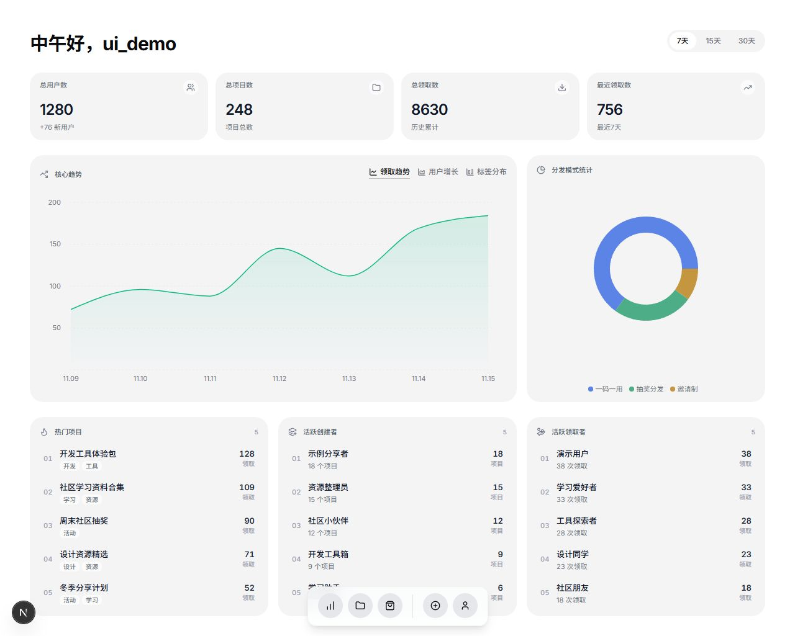
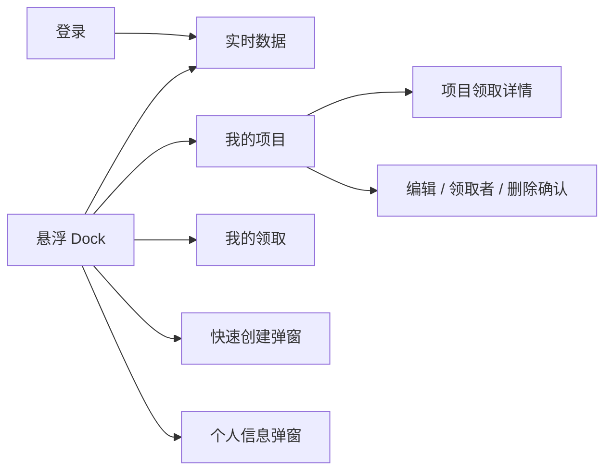

# LINUX DO CDK：UI 界面总览与设计参考

分析日期：2026-11-15。来源：[linux-do/cdk](https://github.com/linux-do/cdk)。本次下载固定在提交 [`9e2bdc6`](https://github.com/linux-do/cdk/tree/9e2bdc6548311ab902f341b3932eac93bde12deb)，以该版本的实际源码为依据。

源码保存在当前项目的 `tmp/linux-do-cdk/`，该目录已被主项目原有的 `tmp/` 规则忽略。分析文档和截图保存在 `docs/`，可以独立阅读和保留。

**CDK 的主视觉是黑白中性色、浅灰大圆角容器、清晰的文字层级和大量留白；导航采用底部可拖动的悬浮 Dock。** 色彩主要用在图表、状态和少量反馈上，主要操作按钮使用黑白主题色。它同时包含管理页的卡片网格、数据看板，以及面向领取者的内容详情页。

## 1. 先看实际界面

本次保存了 10 张原始前端的本地运行截图。账号、统计、项目和领取内容使用虚构演示数据；品牌图标与领取页的公益广告资源沿用上游素材。桌面视口为 1280×720，手机视口为 390×844，长页面另存整页截图。

### 项目管理：浅灰卡片与底部悬浮导航

标题和主要操作在上方，轻量筛选在中间，项目卡片按三列排列。每张卡片的名称、摘要、标签、元信息和操作保持一致的位置，底部 Dock 不占用侧栏宽度。

### 数据看板：数字、趋势与榜单

先读四个统计数字，再看趋势和分发模式，最后查看排行。图表有色彩，其他部分仍保持中性色。

手机项目页与展开后的 Dock 见 [手机截图](assets/08-projects-mobile.jpg)；系统深色主题下的登录页见 [深色登录截图](assets/01-login-desktop.jpg)。完整交互解释和其他截图按下方板块组织。

## 2. 按功能板块阅读

| 功能板块 | 页面与入口 | 文档内容 |
|---|---|---|
| [登录与导航](../登录与导航/CDK-UI设计分析.md) | `/login`、`/callback`、全局 Dock | 极简登录、OAuth 反馈、主题、个人信息、Dock 动效和拖动 |
| [数据看板](../数据看板/CDK-UI设计分析.md) | `/dashboard`，界面称「实时数据」 | 四张统计卡、趋势图、环形图、排行榜与时间范围 |
| [项目管理](../项目管理/CDK-UI设计分析.md) | `/project`，界面称「我的项目」 | 项目卡片、标签筛选、创建/编辑、分发模式、导入、领取者列表 |
| [内容领取](../内容领取/CDK-UI设计分析.md) | `/receive/[projectId]` | 项目说明、领取资格、操作面板、已领取结果、验证与支付状态 |
| [领取记录](../领取记录/CDK-UI设计分析.md) | `/received`，界面称「我的领取」 | 领取概况、趋势、记录表格、搜索、分页和复制 |

实际主导航只有三个页面入口，后面再放两个全局动作：

「快速创建」与「个人信息」是动作，不是新的整页路由。主布局没有渲染固定侧栏；虽然代码中存在 `sidebar.tsx`，当前页面使用的是 `ManagementBar → FloatingDock`。[布局源码](https://github.com/linux-do/cdk/blob/9e2bdc6548311ab902f341b3932eac93bde12deb/frontend/app/%28main%29/layout.tsx#L15)

## 3. 视觉是怎样设计出来的

### 3.1 统一的语义颜色

颜色使用 CSS 变量和 OKLCH 表达，浅色与深色共享 `background`、`foreground`、`primary`、`muted`、`border` 等名称。组件表达的是用途，主题负责提供具体颜色。

| 设计项 | 浅色模式 | 深色模式 | 作用 |
|---|---|---|---|
| 页面背景 | `oklch(1 0 0)`，白色 | `oklch(0.141 0.005 285.823)`，近黑 | 稳定的大面积画布 |
| 主操作 `primary` | `oklch(0.21 0.006 285.885)`，近黑 | `oklch(0.92 0.004 286.32)`，近白 | 按钮和关键动作 |
| 容器 `muted` | `oklch(0.967 0.001 286.375)`，浅灰 | `oklch(0.274 0.006 286.033)`，深灰 | 项目卡片、统计卡和面板 |
| 辅助文字 | 中灰 | 浅灰 | 解释、日期、标签、次要数据 |
| 边界 | 低对比灰色 | 白色 10% 透明度 | 轻量分区和输入轮廓 |

来源：[浅色变量](https://github.com/linux-do/cdk/blob/9e2bdc6548311ab902f341b3932eac93bde12deb/frontend/app/globals.css#L47)、[深色变量](https://github.com/linux-do/cdk/blob/9e2bdc6548311ab902f341b3932eac93bde12deb/frontend/app/globals.css#L84)。图表另有专用色：领取趋势为绿色，领取记录面积图为蓝色；不能把整个产品概括为蓝色主题。

### 3.2 尺寸、字体与留白

| 元素 | 实际规格 | 设计效果 |
|---|---|---|
| 字体 | Inter + Noto Sans SC + 系统回退字体 | 西文、数字和中文层级一致 |
| 全局内容容器 | `max-w-7xl`，默认约 1280px | 大屏保留左右留白 |
| 页面横向内边距 | 16 / 24 / 32 / 48px，随断点增加 | 小屏不挤压，大屏不贴边 |
| 页面标题 | 项目页 24px；看板 26→30px | 先识别所在页面 |
| 项目卡标题 | 15→16px | 控制卡片密度 |
| 摘要与元信息 | 摘要 11→12px；元信息 10→11px | 压低次要信息，但手机阅读需要权衡 |
| 基础圆角 | 基准 10px，衍生 6 / 8 / 10 / 14px | 通用控件保持一致 |
| 业务卡片 | 统计小卡 20px；项目卡及大面板 22px | 较柔和、较明显的容器分组 |
| 弹窗 | 常用 24px 圆角 | 与背景形成独立交互层 |

基础 `Card` 的圆角不代表所有业务页面。项目卡实际直接使用 `rounded-[22px]` 和 `bg-muted`。读组件库时需要继续查看业务组件中的覆盖值。

来源：[字体](https://github.com/linux-do/cdk/blob/9e2bdc6548311ab902f341b3932eac93bde12deb/frontend/app/layout.tsx#L10)、[页面容器](https://github.com/linux-do/cdk/blob/9e2bdc6548311ab902f341b3932eac93bde12deb/frontend/app/%28main%29/layout.tsx#L18)、[项目卡片](https://github.com/linux-do/cdk/blob/9e2bdc6548311ab902f341b3932eac93bde12deb/frontend/components/common/project/ProjectCard.tsx#L83)、[统计卡](https://github.com/linux-do/cdk/blob/9e2bdc6548311ab902f341b3932eac93bde12deb/frontend/components/common/dashboard/DataCards.tsx#L27)。

### 3.3 响应式与动效

- 主要断点沿用 Tailwind 默认值：640px、768px、1024px；Dock 明确以 768px 区分桌面和手机。
- 桌面 Dock 默认在底部居中，以悬浮图标和提示承载导航；手机默认位于右下角，点击后展开。
- 项目列表按一列、两列、三列重排；领取详情从说明与操作双栏转成纵向堆叠。
- 领取记录小屏仍保留可横向滚动的表格，不会自动变成记录卡片。
- 动效用于数字变化、卡片入场、按钮反馈、弹窗和 Dock 悬停放大。它们承担反馈和层级表达，页面主结构仍保持稳定。

Dock 可以长按空白区域后拖动，并按桌面/手机分别保存位置。首次有操作提示；切换屏幕尺寸时也会约束位置，避免控件跑出可视区域。[Dock 逻辑](https://github.com/linux-do/cdk/blob/9e2bdc6548311ab902f341b3932eac93bde12deb/frontend/components/common/layout/ManagementBar.tsx#L41)

## 4. 交互组织方法

| 使用场景 | CDK 的组织方式 | 可学习的做法 |
|---|---|---|
| 浏览多个对象 | 标题、筛选条件、统一卡片网格 | 每张卡保持相同的信息顺序和高度节奏 |
| 设置复杂对象 | 弹窗内区分基本设置和分发内容 | 将复杂表单拆成少量清楚的任务分组 |
| 阅读详情并操作 | 左侧说明，右侧集中主按钮、时间和结果 | 让说明区与动作区各自完整 |
| 查看历史 | 上方趋势，下方可搜索表格 | 先理解变化，再定位具体记录 |
| 暂时加载 | 与最终结构接近的骨架 | 降低空白和布局跳动 |
| 操作结果 | Toast、按钮禁用、状态文字、可复制结果 | 反馈放在用户刚刚操作的位置附近 |

需要保留源码里的实际限制：「实时数据」采用按时间范围缓存 5 分钟，没有自动轮询；「接龙申请」在当前表单中显示开发中；项目列表把部分请求错误合并成空状态。各模块文档对这些细节分别说明，不能把所有可见入口理解为已经完整实现的业务。

## 5. 对 JZClient 的参考价值

| 当前 JZClient | CDK 参考方式 | 适合的调整方向 |
|---|---|---|
| 蓝色管理台、个性中文字体 | 中性色容器、中文无衬线字体、少量状态色 | 先统一文字层级、间距与语义颜色 |
| 当前手表条与较多设置入口 | 项目卡保持标题、摘要、状态、动作的固定位置 | 形成一致的手表卡：名称、型号、电量、在线状态、最后更新 |
| 「我的」集中大量集成配置 | 全局动作使用独立弹窗，业务页面各自承担任务 | 将账号、设备设置、机器人接入分别组织 |
| 多轮 CSS 风格覆盖 | 单套变量支撑浅色与深色 | 先整理最终生效的设计变量，再调整页面 |
| 一份 HTML 集中大量界面逻辑 | 页面、业务组件、基础组件分层 | 可先在现有原生实现中抽出重复渲染与样式 |

最适合优先借鉴的是容器、字号、留白、状态说明和表单分组。悬浮图标 Dock 适合 CDK 当前的少量入口；家长客户端功能更多，导航还要考虑文字可发现性和常用操作的触达。CDK 的部分元信息字号、图标点击区较小，移植到家长手机端时应重新确定尺寸。

## 6. 源码与验证说明

- 技术实现为 Next.js 15.5.27、React 19、TypeScript、Tailwind CSS 4、shadcn/ui / Radix、Motion、Recharts；版本以 `frontend/package.json` 与锁文件为准。
- 下载方式：浅克隆到 `tmp/linux-do-cdk/`；保留完整工作文件和固定提交记录。
- 本地预览辅助程序放在 `tmp/cdk-ui-preview/`，通过本地接口返回虚构数据，不需要数据库、社区账号或支付配置；下载仓库的已跟踪源码保持原样。
- 安装使用项目声明的 pnpm 10.10.0、冻结锁文件、跳过安装脚本。本机 Node 为 v24.11.0，低于仓库声明的 `>=24.22.1 <25`；运行结果仅用于本次 UI 预览，不作为生产环境兼容性结论。
- OAuth、验证码挑战、支付、创建/删除项目等真实业务不属于截图验证范围。状态规则通过源码确认，已展示状态另以本地截图标识。
- 浏览器计算得到的字体栈为 Inter、Inter Fallback、Noto Sans SC、Noto Sans SC Fallback、system-ui，预览没有替换源码中的字体配置。
- 图片左下角的 `N` 和 `1 Issue` 来自 Next.js 开发工具。领取页未配置真实 hCaptcha 站点参数，控制台出现 `[hCaptcha] Request not allowed.`，因此该页只验证详情和结果的展示，不验证真实领取。
- 原始项目采用 MIT 许可证；本目录保留来源与固定提交链接，截图用于本项目的 UI 设计参考。

### 截图清单

| 截图 | 实际展示范围 |
|---|---|
| [登录页](assets/01-login-desktop.jpg) | 深色主题、未登录状态、单一 OAuth 入口 |
| [数据看板](assets/02-dashboard-desktop.jpg) | 浅色主题、统计卡、趋势、分发模式、三个榜单 |
| [项目管理](assets/03-projects-desktop.jpg) | 浅色主题、六张项目卡、三个时间状态、底部 Dock |
| [基本设置弹窗](assets/04-create-dialog.jpg) | 标题、分组 Tabs、名称、标签、时间和门槛；内容区可滚动 |
| [分发内容弹窗](assets/11-distribution-dialog.jpg) | 三种模式入口、导入区、待提交内容区 |
| [领取前](assets/05-receive-desktop.jpg) | 项目说明与右侧领取面板 |
| [已领取](assets/06-received-content.jpg) | 已领取 Badge、正文内容与右侧复制区 |
| [领取记录](assets/07-received-desktop.jpg) | 统计、蓝色趋势图、五条演示记录与分页 |
| [手机项目页](assets/08-projects-mobile.jpg) | 390px 宽度、一列卡片、展开后的悬浮导航 |
| [个人信息面板](assets/10-account-menu.jpg) | 浅色弹窗、账户、分数、主题、商户配置和链接 |
