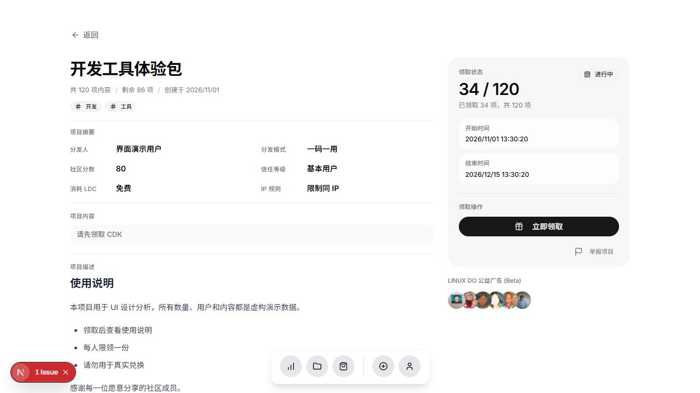
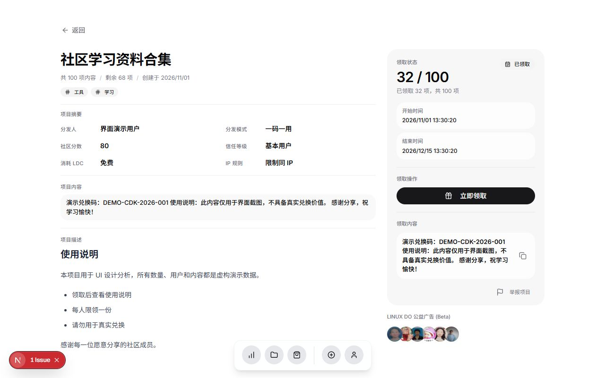

# CDK 内容领取：UI 设计分析

分析日期：2026-11-15。来源：[linux-do/cdk](https://github.com/linux-do/cdk)，固定提交 [`9e2bdc6`](https://github.com/linux-do/cdk/tree/9e2bdc6548311ab902f341b3932eac93bde12deb)。

本篇根据下载源码分析 `/receive/[projectId]`，覆盖领取详情、资格判断、验证码、支付回跳、领取结果和举报。状态规则来自实现，页面布局另用本地演示接口预览；验证码挑战、真实领取和支付未做联调。



右侧公益头像沿用上游自带资源。左下角 `1 Issue` 为本地开发工具提示：预览没有配置真实 hCaptcha 站点参数，控制台报告 `Request not allowed`；不应将此截图理解为真实领取流程已经通过。

## 1. 界面长什么样

这是一个内容详情页，重点是让用户先判断项目是否适合自己，再完成一次领取。页面宽度限制为 `max-w-5xl`，顶部只有轻量的“返回”按钮，主体在大屏排列为左侧说明、右侧领取面板。右栏最小宽度 300px，并在桌面滚动时保持在顶部附近。[布局源码][layout]

```text
返回
┌────────────────────────────┬───────────────────┐
│ 项目名称                   │ 领取状态   进行中 │
│ 总数 / 剩余 / 创建日期      │ 已领取数 / 总数   │
│ 标签                       │ 开始时间          │
│                            │ 结束时间          │
│ 项目摘要                   │                   │
│ 发布者、分发方式、等级等    │ [立即领取]        │
│                            │                   │
│ 项目内容 / 请先领取 CDK     │ 已领取内容 + 复制 │
│ 项目描述（Markdown）       │        举报项目   │
└────────────────────────────┴───────────────────┘
```

左侧先给项目名称、库存和标签，再列“项目摘要”，最后展示内容与描述。右侧把数量、时间、主按钮集中起来。已领取内容同时出现在左侧正文和右侧复制区，用户无需回到列表查找结果。

## 2. 视觉层级与响应式

| 设计位置 | 具体实现 | 视觉作用 |
|---|---|---|
| 项目名称 | 26px，`sm` 起 30px，加粗，紧字距 | 建立页面第一阅读点 |
| 数量与创建日期 | 12px 次要文字，使用 `/` 分隔 | 信息保持连续，不增加单独卡片 |
| 项目标签 | 最多 10 个，10px 字号、20px 高、胶囊圆角、`#` 图标 | 作为轻量分类线索 |
| 摘要信息 | 11px 标签、14px 半粗值；上下细分隔线 | 采用键值信息层级而非堆叠按钮 |
| 领取面板 | 22px 圆角，`bg-muted/70`，16–20px 内边距 | 从正文中区分操作区域 |
| 时间与结果块 | 18px 圆角，`bg-background/80` | 在面板内部形成较浅的一层 |
| 主操作按钮 | 36px 高，全宽，胶囊圆角，无明显阴影 | 一个清楚的主动作 |
| 正文内容块 | 16px 圆角、浅灰语义背景、13px 字号 | 让短内容可扫读，长内容可换行 |

颜色主要使用 `foreground`、`muted`、`background` 等主题变量；边界分别为浅色 `black/6` 和深色 `white/0.06`。该页面以中性色和文字层级建立秩序，没有为每项摘要分配独立彩色背景。[视觉源码][layout]

`lg` 起采用约 2:1 双栏，右栏 `sticky top-6`；较窄屏幕按“全部说明 → 领取面板”纵向排列。摘要在 `sm` 起为两列。开始与结束时间在 `sm` 为两列，到了桌面右栏又回到一列，适应右栏宽度。[响应式源码][action-panel]

页面使用约 0.5–0.6 秒淡入与轻微上移，子项错开出现。加载骨架直接模仿标题、摘要和右侧操作面板，数据未返回时仍能识别页面结构。[骨架与动效][loading]

## 3. 领取条件如何呈现

摘要展示分发人、分发模式、社区分数、最低信任等级、消耗 LDC、同 IP 规则。分发人链接至社区个人主页；“社区分数”显示为 `100 - risk_level`。免费项目直接写“免费”，付费项目写出金额与 LDC 单位。[摘要字段][metadata]

分发模式名称为“一码一用、抽奖分发、邀请制”。领取详情复用同一页面；这里没有独立抽奖动画或邀请管理界面，模式差异主要通过摘要和服务端结果表达。[模式名称][modes]

主按钮按以下顺序判断，优先显示最先命中的状态：[按钮分支][button-states]

| 条件 | 按钮表现 |
|---|---|
| 尚未到开始时间 | 禁用；“时间未到”，附剩余天/时/分/秒 |
| 超过结束时间 | 禁用；“项目已结束” |
| 付费项目已无库存，且正在检查待支付订单 | 禁用；旋转图标与“正在检查待支付订单” |
| 存在有效待支付订单 | “继续支付 金额 LDC”；跳转前显示“正在打开支付页面” |
| 库存为零 | 禁用；“库存已空” |
| 无用户信息或信任等级不足 | 禁用；“信任等级不足” |
| 项目标记为完成 | 禁用；“项目已完成” |
| 正在验证 | 禁用；旋转图标与“验证中...” |
| 具备领取条件 | 免费显示“立即领取”；付费显示“支付 金额 LDC 并领取” |

顶部状态 Badge 另有判断：已完成、已领取、未开始、已结束、已领完、进行中。它与按钮不是同一套判断函数，因此分析截图时应同时看状态、库存和操作文案。

## 4. 从点击领取到显示结果

1. 页面先请求项目详情；失败后提供“获取项目信息失败”、具体原因、“返回”和“重试”，不只显示空白区域。
2. 点击主按钮会先检查是否已领取、是否正在验证以及项目时间，然后触发不可见 hCaptcha。
3. 页面没有常驻验证码输入框；挑战由 `size="invisible"` 的 hCaptcha 按需呈现。验证失败、过期分别用 Toast 说明，关闭挑战会结束验证中的状态。
4. 免费领取成功后，更新库存、已领取状态和内容，显示“领取成功！”；不要求用户跳转新页面。
5. 付费项目在领取接口返回支付地址后直接跳到外部支付页；金额已经显示在主按钮上，源码没有额外的站内付款确认弹窗。
6. 带 `trade_no` 回到详情且仍未领取时，出现“付款处理中”提示条；每 2 秒查询详情，最多 15 次。到账后展示内容；超时则提示稍后手动刷新。

对应实现：[详情加载][loading]、[领取与支付跳转][receive-flow]、[验证码][captcha]、[支付回跳][payment-return]。

付费项目重新进入页面时会检查待支付订单。选择“继续支付”后还会重新确认订单是否有效；过期用明确文案反馈。商户的 `PaymentSettingsDialog` 是收款配置入口，不是这里的付款确认步骤。

## 5. 内容展示、复制与次要操作



此状态由演示 GET 接口直接提供，没有执行领取请求。可同时看到“已领取”状态、正文内容与右侧复制区；仍显示“立即领取”的细节见第 8 节。

领取前，“项目内容”区域显示“请先领取 CDK”；领取后按照返回内容的分隔符拆成多条浅底块。右侧“领取内容”区用 `code` 文本、自动断行和每条独立的复制图标呈现。复制时会清理类似“兑换码:”的前缀，并显示“复制成功”。详情页没有单独的内容下载按钮。[内容与复制][copy]

“项目描述”使用 Markdown 渲染；为空时显示“暂无项目描述”。它与领取结果分开，避免把发布者的说明文字和真正的兑换内容混在一起。[正文布局][description]

举报入口位于操作卡右下角，用 11px 次要文字和小旗图标呈现。打开后是最大约 425px 的弹窗，包含理由输入、`当前字数/255`、取消和提交；未填写或提交中会禁用提交。成功后关闭弹窗并变成“已举报”，重复举报响应也会同步该状态。[举报组件][report]

右侧面板下方还有可选的“LINUX DO 公益广告（Beta）”：从 `/heart.json` 随机取最多 6 项，以叠放头像呈现，悬停显示图片和信息，点击打开详情链接。数据不可用时整块不显示。[附属信息][volunteer]

## 6. 风控和错误反馈

| 场景 | 反馈层级 |
|---|---|
| 详情加载失败、项目不存在 | 页面级空状态，保留返回与重试 |
| 验证失败、领取失败、订单过期 | Toast，给出可操作的错误说明 |
| 付款回调尚未到账 | 页面内持续提示条，配旋转图标和自动查询 |
| API 返回风险提醒头 | 可关闭的常驻 Toast，显示风险标签与说明 |
| API 返回 `403 + RISK_BLOCKED` | 全局“账号存在风险”对话框，禁止点击外部或 Esc 关闭 |

风险内容采用独立信息卡，等级用警示 Badge、风险项用“标签 + 小字解释”呈现。提醒与阻断从统一 API 层触发，挂在全局布局上，因此可能覆盖领取页，而非领取组件私有状态。[风控接入][risk-api]、[阻断弹窗][risk-dialog]

## 7. 对当前手表项目可借鉴的设计

| CDK 的具体做法 | 在 JZClient 中的适用位置 |
|---|---|
| 左说明、右操作；手机按阅读顺序堆叠 | 手表详情、设备绑定、AI 配置的说明与操作组织 |
| 在动作旁给出条件和时间 | 发送媒体前展示大小/时长，设备命令旁展示状态与更新时间 |
| 禁用按钮直接解释原因 | 型号不支持、设备未绑定、会话不可用时说明具体限制 |
| 操作成功后原位展示可复制结果 | 生成好友口令、生成链接、查看接口访问地址 |
| 骨架与最终内容结构一致 | 定位、健康和概览等需要多个接口聚合的页面 |
| 有界等待加手动重试出口 | 等待手表回执、上传转码、设备状态刷新 |

复用时应保留信息层级和状态反馈，字段和动作按手表业务重新安排。CDK 的社区等级、积分支付和公益展示不是手表详情的必要组成。

## 8. 当前实现中需要留意的细节

- 已领取后会出现“已领取”状态和复制区，但 `ReceiveButton` 没有单独判断 `is_received`；满足其他条件时仍可能显示“立即领取”。点击处理函数用 `hasReceived` 提前返回，阻止重复请求。按钮文案和完成状态存在可改善的一致性问题。[按钮][button-states]、[点击处理][receive-flow]
- 手机页面先完成左侧说明再呈现领取面板；长描述会把主操作推到较后的位置。没有实现手机端独立吸底领取按钮。[布局][layout]
- hCaptcha 固定设置 `theme="light"`。源码对挑战框附加了暗色 CSS，但跨域挑战的真实呈现需要另行验证，不能据此断言其深色模式已经一致。[验证码][captcha]
- 全局风控阻断弹窗刻意不提供关闭动作；若参考该设计，应同时考虑用户可理解的恢复路径。[阻断弹窗][risk-dialog]

[layout]: https://github.com/linux-do/cdk/blob/9e2bdc6548311ab902f341b3932eac93bde12deb/frontend/components/common/receive/ReceiveContent.tsx#L563
[action-panel]: https://github.com/linux-do/cdk/blob/9e2bdc6548311ab902f341b3932eac93bde12deb/frontend/components/common/receive/ReceiveContent.tsx#L693
[loading]: https://github.com/linux-do/cdk/blob/9e2bdc6548311ab902f341b3932eac93bde12deb/frontend/components/common/receive/ReceiveMain.tsx#L19
[metadata]: https://github.com/linux-do/cdk/blob/9e2bdc6548311ab902f341b3932eac93bde12deb/frontend/components/common/receive/ReceiveContent.tsx#L479
[modes]: https://github.com/linux-do/cdk/blob/9e2bdc6548311ab902f341b3932eac93bde12deb/frontend/components/common/project/constants.ts#L49
[button-states]: https://github.com/linux-do/cdk/blob/9e2bdc6548311ab902f341b3932eac93bde12deb/frontend/components/common/receive/ReceiveContent.tsx#L60
[receive-flow]: https://github.com/linux-do/cdk/blob/9e2bdc6548311ab902f341b3932eac93bde12deb/frontend/components/common/receive/ReceiveContent.tsx#L318
[captcha]: https://github.com/linux-do/cdk/blob/9e2bdc6548311ab902f341b3932eac93bde12deb/frontend/components/common/receive/ReceiveVerify.tsx#L32
[payment-return]: https://github.com/linux-do/cdk/blob/9e2bdc6548311ab902f341b3932eac93bde12deb/frontend/components/common/receive/ReceiveContent.tsx#L447
[copy]: https://github.com/linux-do/cdk/blob/9e2bdc6548311ab902f341b3932eac93bde12deb/frontend/components/common/receive/ReceiveContent.tsx#L171
[description]: https://github.com/linux-do/cdk/blob/9e2bdc6548311ab902f341b3932eac93bde12deb/frontend/components/common/receive/ReceiveContent.tsx#L661
[report]: https://github.com/linux-do/cdk/blob/9e2bdc6548311ab902f341b3932eac93bde12deb/frontend/components/common/receive/ReportButton.tsx#L100
[volunteer]: https://github.com/linux-do/cdk/blob/9e2bdc6548311ab902f341b3932eac93bde12deb/frontend/components/common/receive/ReceiveContent.tsx#L202
[risk-api]: https://github.com/linux-do/cdk/blob/9e2bdc6548311ab902f341b3932eac93bde12deb/frontend/lib/services/core/api-client.ts#L211
[risk-dialog]: https://github.com/linux-do/cdk/blob/9e2bdc6548311ab902f341b3932eac93bde12deb/frontend/components/common/risk/risk-block-dialog.tsx#L42
