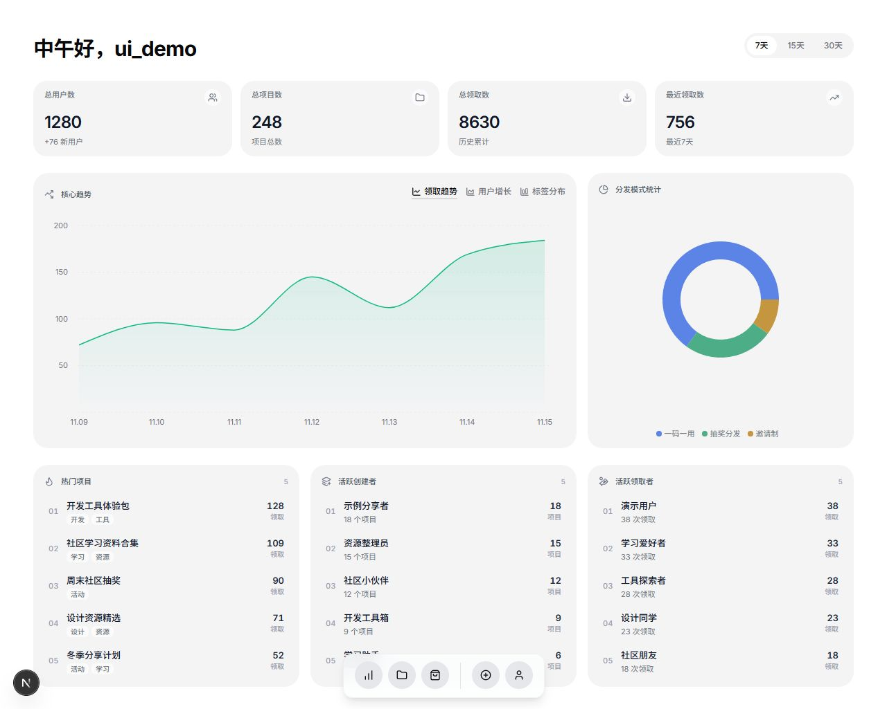

# CDK 数据看板：UI 设计分析

分析日期：2026-11-15。路由：`/dashboard`，页面名称为「实时数据」。

来源：[linux-do/cdk](https://github.com/linux-do/cdk)，固定提交 `9e2bdc6548311ab902f341b3932eac93bde12deb`。本文结合该版本源码与本地前端预览说明布局和交互，演示数据不代表线上统计。



截图使用 1280px 桌面宽度并保存整页，包含下方三个榜单。

## 1. 页面长什么样

它是浅灰模块组成的数据看板。主视觉依次是问候语、四个大数字、趋势图与环形图、三个排行榜。色彩集中在图表，容器通过背景色和圆角区分，不依赖粗边框。

```text
按中国时区生成的问候语与用户名             [7天 | 15天 | 30天]

[总用户数]          [总项目数]          [总领取数]          [最近领取数]

[核心趋势：领取趋势 / 用户增长 / 标签分布        ] [分发模式统计]
[                    约 2/3 宽                 ] [环形图 1/3 宽]

[热门项目]                    [活跃创建者]                 [活跃领取者]
```

以上是大屏结构；小屏会重排为纵向内容。主页面的分组与网格见 [DashboardMain.tsx:150](https://github.com/linux-do/cdk/blob/9e2bdc6548311ab902f341b3932eac93bde12deb/frontend/components/common/dashboard/DashboardMain.tsx#L150)。

## 2. 信息层级与视觉规格

| 区域 | 展示内容 | 实现中的视觉处理 |
|---|---|---|
| 页首 | 「早上/中午/下午/晚上好，用户名」及日期范围 | 标题 26px，`sm` 起 30px；粗体、紧字距、超长省略；右侧胶囊选项不压缩 |
| 统计卡 | 总用户、总项目、历史领取、所选时间段领取 | 20px 圆角、`bg-muted` 底色；最小高度 88px，`sm` 起 96px |
| 卡内标签 | 指标名称及解释 | 标签与解释 11px 灰字；右上角 24px 圆底小图标 |
| 卡内数字 | 当前数值 | 20px，`sm` 起 24px；较粗字重、紧字距，并使用数字增长动画 |
| 图表容器 | 核心趋势与分发模式 | 22px 圆角、浅灰底；图表区高度约 300px |
| 排行榜 | 项目/用户名称、名次、标签或统计 | 22px 圆角；名称 13px、解释 11px、指标右对齐；行高至少 42px |

统计卡的具体尺寸见 [DataCards.tsx:27](https://github.com/linux-do/cdk/blob/9e2bdc6548311ab902f341b3932eac93bde12deb/frontend/components/common/dashboard/DataCards.tsx#L27)。排行榜见 [DataCards.tsx:230](https://github.com/linux-do/cdk/blob/9e2bdc6548311ab902f341b3932eac93bde12deb/frontend/components/common/dashboard/DataCards.tsx#L230)。

统计卡没有把每个指标做成不同颜色的色块。主组件虽然配置了 `descColor`，但当前 `StatCard` 没有消费这个属性，说明文字仍采用统一灰色；不能仅根据配置对象把它描述成绿/蓝双色说明。

## 3. 图表是怎么设计的

| 图表 | 图形与颜色 | 交互与数据处理 |
|---|---|---|
| 领取趋势 | 绿色 `#10b981` 细线面积图；填充从约 24% 透明度渐隐 | 默认显示；悬停看日期和数值；曲线为平滑 `monotone` |
| 用户增长 | `--chart-1` 主题色面积图；浅色主题偏橙、深色主题偏蓝 | 与领取趋势共用时间范围和日期补齐逻辑 |
| 标签分布 | 多色圆顶柱状图，最多十列 | 按数值降序取前十；长标签截断，Tooltip 补充信息 |
| 分发模式 | 内半径 58、外半径 84 的环形图 | 悬停显示数量与占比；底部圆点图例对应一码一用、抽奖分发、邀请制 |

时间图只保留横向虚线网格，不绘制粗轴线和刻度短线。纵轴不显示小数，并隐藏零刻度文字。7 天显示全部日期；15 天约每两天一个刻度，30 天约每三天一个刻度，另外保留末日。

分类与环图共用蓝、绿、金、粉、紫等七种较柔和颜色。配色与坐标处理见 [DataCharts.tsx:18](https://github.com/linux-do/cdk/blob/9e2bdc6548311ab902f341b3932eac93bde12deb/frontend/components/common/dashboard/DataCharts.tsx#L18)；面积图见 [DataCharts.tsx:335](https://github.com/linux-do/cdk/blob/9e2bdc6548311ab902f341b3932eac93bde12deb/frontend/components/common/dashboard/DataCharts.tsx#L335)；环形图见 [DataCharts.tsx:472](https://github.com/linux-do/cdk/blob/9e2bdc6548311ab902f341b3932eac93bde12deb/frontend/components/common/dashboard/DataCharts.tsx#L472)。

## 4. 筛选、排行榜与动效

- 默认时间范围为 7 天。页首 7/15/30 天选项切换后重新取得该范围数据；核心趋势的三个标签只在已取得的数据中切换图形。
- 「热门项目」「活跃创建者」「活跃领取者」各最多显示十条，名次补齐为 `01`、`02` 等两位数字。
- 项目最多显示两个标签；用户有头像时展示 24px 圆头像，没有头像则保留序号。数字使用等宽数字特性，便于纵向比较。
- 排行榜行悬停时背景略微提亮，但当前实现没有点击跳转处理，不能将其当作项目详情入口。
- 页面使用淡入、向上 20px 后归位、子区域错峰出现；图表有约 1.15–1.35 秒的展开动画。动效服务于初次阅读，没有自动轮播。

列表裁剪与行内容见 [DataCards.tsx:66](https://github.com/linux-do/cdk/blob/9e2bdc6548311ab902f341b3932eac93bde12deb/frontend/components/common/dashboard/DataCards.tsx#L66)；页面入场动效见 [DashboardMain.tsx:121](https://github.com/linux-do/cdk/blob/9e2bdc6548311ab902f341b3932eac93bde12deb/frontend/components/common/dashboard/DashboardMain.tsx#L121)。

## 5. 响应式策略

| 元素 | 小屏 | 较大屏幕 |
|---|---|---|
| 统计卡 | 两列 | `lg` 起四列 |
| 核心趋势与分发图 | 各占一整行 | `lg` 起三列网格，趋势跨两列 |
| 三个排行榜 | 一列 | `md` 起两列，`lg` 起三列 |
| 图表标题与标签 | 纵向排列 | `sm` 起横向排列 |
| 问候语 | 允许截断以保证范围控件可见 | 字号增大，保持左右结构 |

这套响应式主要是栅格重排和文本省略。它没有为手机另写一套图表，图形通过容器宽度适配。

## 6. 数据状态与实现边界

看板通过 `GET /api/v1/dashboard/stats/all?days=7` 取得汇总数据。前端按日期范围维护一份 **5 分钟内存缓存**，没有定时轮询、WebSocket 或 SSE。虽然页面名叫「实时数据」，本版本行为更接近按需获取的统计看板。见 [use-dashboard.ts:27](https://github.com/linux-do/cdk/blob/9e2bdc6548311ab902f341b3932eac93bde12deb/frontend/hooks/use-dashboard.ts#L27)。

| 状态 | 当前页面表现 |
|---|---|
| 图表加载 | 300px 区域内显示蓝色转圈与「数据加载中…」 |
| 无标签/分发/榜单数据 | 居中图标和「暂无数据」 |
| 时间序列缺日期 | 补齐所选范围，缺失日期填零；完全空数组也生成零序列 |
| 请求失败 | Hook 保存错误并保留旧数据或默认零值；主组件只读取 `data/isLoading`，没有显示错误详情或更新时间 |

图表的加载态见 [DataCharts.tsx:238](https://github.com/linux-do/cdk/blob/9e2bdc6548311ab902f341b3932eac93bde12deb/frontend/components/common/dashboard/DataCharts.tsx#L238)；失败回退见 [use-dashboard.ts:135](https://github.com/linux-do/cdk/blob/9e2bdc6548311ab902f341b3932eac93bde12deb/frontend/hooks/use-dashboard.ts#L135)。

## 7. 对当前手表项目的设计参考

1. 可以沿用「四项摘要 → 一张主趋势 → 补充明细」的阅读顺序，把摘要换为设备在线状态、当前电量、今日步数、未读消息。指标应优先回答家长的问题。
2. 7/15/30 天胶囊切换和图表标签可以用于步数、睡眠、活动趋势，避免同屏摆放过多图形。
3. 数字、图标、说明分三层，灰色容器保持安静，只给趋势和异常状态使用强调色。
4. 可以借鉴卡片栅格和榜单行，但应保留手表项目已有的状态采样时间、未知状态和来源说明。
5. 不宜直接套用失败回退为零、缺数据补零的行为：手表未上报和真实零值需要区分；应明确显示「暂无采样」或断点。

[返回 CDK 界面总览](../UI设计参考/CDK-界面总览.md)
