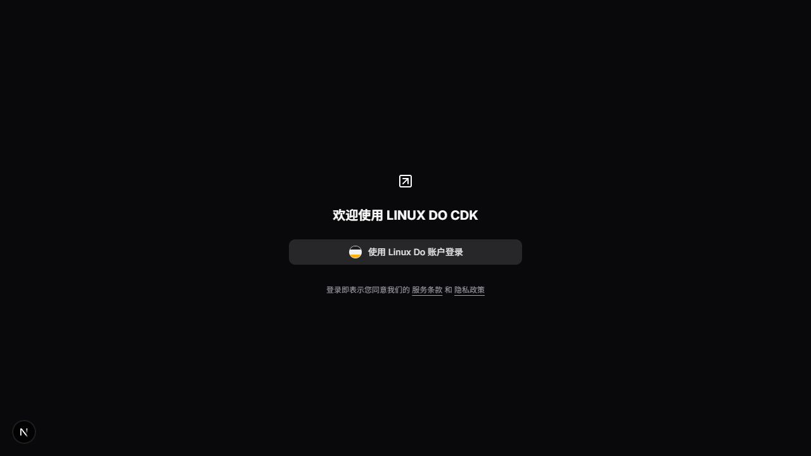
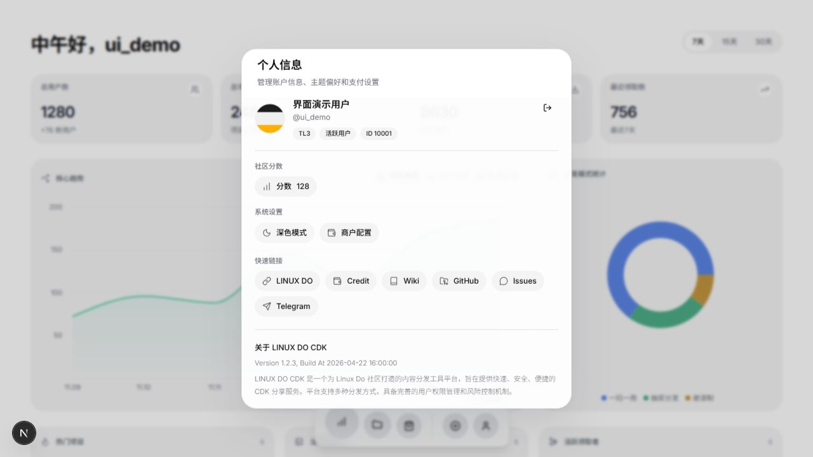

# LINUX DO CDK：登录与导航 UI 设计分析

- 分析日期：2026-11-15。
- 来源：[linux-do/cdk](https://github.com/linux-do/cdk)。
- 固定版本：[9e2bdc6548311ab902f341b3932eac93bde12deb](https://github.com/linux-do/cdk/tree/9e2bdc6548311ab902f341b3932eac93bde12deb)。下文源码链接均指向这一提交。
- 分析范围：登录、OAuth 回调、主布局、悬浮导航、个人信息、主题与基础组件。
- 验证方式：源码分析结合原始前端的本地截图；登录页、首次导航引导、个人信息面板与浅色切换已查看，OAuth 账号流程未做真实联调。

## 1. 界面第一印象

CDK 使用黑、白、中性灰作为基础色，以留白、细边框和圆角组织界面。登录页只有居中的小图标、欢迎语、一个 OAuth 按钮和条款入口；登录后的导航则是悬浮在内容之上的图标 Dock。

页面没有在主布局中渲染传统的固定侧栏或顶部导航。仓库虽然保留 `sidebar.tsx` 和侧栏颜色变量，但实际主布局加载的是 `ManagementBar → FloatingDock`，识别当前设计应以这条组件链为准。[主布局](https://github.com/linux-do/cdk/blob/9e2bdc6548311ab902f341b3932eac93bde12deb/frontend/app/%28main%29/layout.tsx#L15)



图中是跟随系统深色主题的未登录页，视口 1280×720；左下角 `N` 为 Next.js 开发工具入口。

## 2. 登录页怎么排

登录首屏的信息顺序如下，按钮之外的大部分空间留白：

```text
                右上箭头线性图标
            欢迎使用 LINUX DO CDK
             登录/登出状态提示
       [ Linux Do 标志 + 使用账户登录 ]
       登录即表示同意 服务条款 和 隐私政策
```

- 最终定位由 `LoginForm` 内的 `fixed inset-0` 决定，内容垂直、水平居中；内部容器 `max-w-md`，默认上限约 448px，左右 24px、上下 32px 内边距。[布局源码](https://github.com/linux-do/cdk/blob/9e2bdc6548311ab902f341b3932eac93bde12deb/frontend/components/common/auth/LoginForm.tsx#L74)
- 标题为 `text-xl font-bold`，默认约 20px；主要组间距 `gap-6`，约 24px。小图标、标题、按钮形成单一阅读轴。
- 容器虽然有 `rounded-2xl`，自身没有设置明显的卡片底色、边框或投影；浅色主题下呈现的是画布上的内容组。
- 主按钮为约 40px 高的 `LiquidButton`。常态为浅灰底，悬浮时主色填满背景并轻微放大至 1.05 倍，按下缩至 0.95 倍。[按钮实现](https://github.com/linux-do/cdk/blob/9e2bdc6548311ab902f341b3932eac93bde12deb/frontend/components/animate-ui/buttons/liquid.tsx#L9)
- 没有账号和密码输入框，主要动作是通过 Linux Do OAuth 登录。点击后按钮禁用、图标改为旋转加载图标、文案改为“正在跳转…”。[按钮状态](https://github.com/linux-do/cdk/blob/9e2bdc6548311ab902f341b3932eac93bde12deb/frontend/components/common/auth/LoginForm.tsx#L102)
- 服务条款、隐私政策使用小号灰字链接打开弹窗，长内容再分成可折叠章节；不会把全部条文铺在登录首屏。[条款弹窗](https://github.com/linux-do/cdk/blob/9e2bdc6548311ab902f341b3932eac93bde12deb/frontend/components/common/auth/LoginForm.tsx#L129)

登录前后的反馈维持同一视觉结构：

| 状态 | 页面呈现与处理 |
|---|---|
| 已有有效账号 | 登录页检测成功后进入 `/dashboard` |
| 刚退出 | 显示“您已成功登出平台”，再去掉地址栏中的 `logout` 参数 |
| 准备 OAuth | 保存目标页面，向后端取授权地址，按钮显示等待状态 |
| OAuth 回调 | 显示“正在验证”，成功显示绿色反馈，约一秒后转到目标页面 |
| 回调失败 | 显示具体错误和“重新登录”按钮 |

来源：[登录状态处理](https://github.com/linux-do/cdk/blob/9e2bdc6548311ab902f341b3932eac93bde12deb/frontend/components/common/auth/LoginForm.tsx#L31)、[授权服务](https://github.com/linux-do/cdk/blob/9e2bdc6548311ab902f341b3932eac93bde12deb/frontend/lib/services/auth/auth.service.ts#L42)、[回调页面](https://github.com/linux-do/cdk/blob/9e2bdc6548311ab902f341b3932eac93bde12deb/frontend/components/common/auth/CallbackHandler.tsx#L80)。

## 3. 登录后的导航怎么设计

### 3.1 五个入口，区分页面与全局动作

| Dock 顺序 | 悬浮提示名称 | 行为 |
|---|---|---|
| 1 | 实时数据 | 进入 `/dashboard` |
| 2 | 我的项目 | 进入 `/project` |
| 3 | 我的领取 | 进入 `/received` |
| 分隔线 | 无 | 桌面上分开页面导航与全局动作 |
| 4 | 快速创建 | 打开创建项目弹窗 |
| 5 | 个人信息 | 打开账户、主题、商户配置与链接面板 |

Dock 常态只显示图标，桌面鼠标悬停后才显示上述文字提示。前三个入口使用链接；后两个将弹窗触发器嵌入图标容器。[入口配置](https://github.com/linux-do/cdk/blob/9e2bdc6548311ab902f341b3932eac93bde12deb/frontend/components/common/layout/ManagementBar.tsx#L370)

### 3.2 桌面悬浮条

- 默认位于窗口底部居中，与边缘保留 16px。主条约 64px 高，70% 不透明的主题背景、背景模糊、细边框和柔和阴影构成轻玻璃效果。[位置计算](https://github.com/linux-do/cdk/blob/9e2bdc6548311ab902f341b3932eac93bde12deb/frontend/components/common/layout/ManagementBar.tsx#L162)、[样式配置](https://github.com/linux-do/cdk/blob/9e2bdc6548311ab902f341b3932eac93bde12deb/frontend/components/common/layout/ManagementBar.tsx#L671)
- 图标装在圆形浅灰容器中。鼠标接近时，外容器由 40px 向 70px 放大，内部图标区域由 20px 向 35px 放大，使用弹簧动画平滑回落。[缩放映射](https://github.com/linux-do/cdk/blob/9e2bdc6548311ab902f341b3932eac93bde12deb/frontend/components/ui/floating-dock.tsx#L269)
- 长按空白区域 180ms 后可以拖动；按钮、链接等交互元素不会触发拖拽。拖动结束短暂抑制点击，避免松手时误打开入口。[拖动逻辑](https://github.com/linux-do/cdk/blob/9e2bdc6548311ab902f341b3932eac93bde12deb/frontend/components/common/layout/ManagementBar.tsx#L305)
- 桌面和手机位置分别记在 localStorage；改变窗口尺寸时会按原来的相对位置重新计算，并限制在可见区域内。[位置持久化](https://github.com/linux-do/cdk/blob/9e2bdc6548311ab902f341b3932eac93bde12deb/frontend/components/common/layout/ManagementBar.tsx#L126)
- 首次使用时显示小型“菜单栏引导”，逐步解释拖动、创建和个人信息；完成后记住已读状态。[引导步骤](https://github.com/linux-do/cdk/blob/9e2bdc6548311ab902f341b3932eac93bde12deb/frontend/components/common/layout/ManagementBar.tsx#L275)

### 3.3 手机悬浮按钮


断点为 768px。窄屏默认在右下方显示约 48px 的圆形按钮，点击后五个入口向上排成一列；入口按顺序淡入、上移，主按钮图标旋转 180°。手机隐藏桌面的分隔线，也不常驻文字标签。[手机版 Dock](https://github.com/linux-do/cdk/blob/9e2bdc6548311ab902f341b3932eac93bde12deb/frontend/components/ui/floating-dock.tsx#L76)

主内容自身保持居中，最大宽度约 1280px；横向内边距依次为 16、24、32、48px，内容组间距从 16px 增至 24px。导航浮在内容之上，不占用一整列。[主内容尺寸](https://github.com/linux-do/cdk/blob/9e2bdc6548311ab902f341b3932eac93bde12deb/frontend/app/%28main%29/layout.tsx#L18)

## 4. 个人信息面板



“个人信息”是最大宽度约 520px 的居中弹窗，内容区可独立滚动，按下面的顺序分组：

1. 48px 圆形头像、昵称、用户名、信任等级/ID 标签，右侧是登出图标。
2. 社区分数：胶囊形小块配数字递增动画。
3. 系统设置：主题切换和商户配置，使用图标加文字的胶囊按钮。
4. 快速链接：LINUX DO、Credit、Wiki、GitHub、Issues、Telegram。
5. 关于信息：版本、构建日期和简短项目说明。

它把低频账户与站点设置收进同一个轻量面板，主页面继续专注项目、统计和领取。[面板结构](https://github.com/linux-do/cdk/blob/9e2bdc6548311ab902f341b3932eac93bde12deb/frontend/components/common/layout/ManagementBar.tsx#L402)

## 5. 可复用的视觉规则

| 项目 | 源码中的规则 | 形成的观感 |
|---|---|---|
| 浅色画布 | `--background: oklch(1 0 0)` | 白底与内容留白成为主要背景 |
| 浅色主色 | `--primary: oklch(0.21 0.006 285.885)` | 接近黑色，主操作强调对比而非饱和色 |
| 次级层级 | `muted`、`muted-foreground`、`border` 语义变量 | 浅灰块、灰色说明、轻边框分层 |
| 深色画布 | `--background: oklch(0.141 0.005 285.823)` | 深灰黑背景，卡片略亮，文字转近白 |
| 字体 | Inter + Noto Sans SC + 系统回退 | 中英文使用常规无衬线字体 |
| 基础圆角 | 基准 10px；`md` 8px、`lg` 10px、`xl` 14px | 按钮与卡片有统一圆角尺度 |
| 基础按钮 | 默认高 36px、14px 字号，主/次/描边/幽灵等变体 | 明确控制操作权重和密度 |
| 基础卡片 | 24px 内边距与间距、细边框、轻阴影 | 内容分组整齐且层次克制 |
| 弹窗 | 24px 圆角、95% 不透明背景、较柔的外阴影 | 比普通卡片更突出，但仍延续中性色 |
| 反馈颜色 | Toast 成功绿、错误红、警告黄、信息蓝 | 彩色主要承担状态语义 |

来源：[全局令牌](https://github.com/linux-do/cdk/blob/9e2bdc6548311ab902f341b3932eac93bde12deb/frontend/app/globals.css#L46)、[字体](https://github.com/linux-do/cdk/blob/9e2bdc6548311ab902f341b3932eac93bde12deb/frontend/app/layout.tsx#L10)、[按钮](https://github.com/linux-do/cdk/blob/9e2bdc6548311ab902f341b3932eac93bde12deb/frontend/components/ui/button.tsx#L7)、[卡片](https://github.com/linux-do/cdk/blob/9e2bdc6548311ab902f341b3932eac93bde12deb/frontend/components/ui/card.tsx#L5)、[弹窗](https://github.com/linux-do/cdk/blob/9e2bdc6548311ab902f341b3932eac93bde12deb/frontend/components/ui/dialog.tsx#L64)。表中 px 按浏览器默认 16px 根字号换算。

主题由 `next-themes` 管理，首次默认跟随系统并避免切换时播放全站颜色过渡。个人信息中的按钮直接切换浅色/深色，没有单独展示“恢复跟随系统”选项。[主题挂载](https://github.com/linux-do/cdk/blob/9e2bdc6548311ab902f341b3932eac93bde12deb/frontend/app/layout.tsx#L46)、[切换逻辑](https://github.com/linux-do/cdk/blob/9e2bdc6548311ab902f341b3932eac93bde12deb/frontend/hooks/use-theme-utils.tsx#L74)

## 6. 动效与组件组织

`components/ui` 提供基础组件，`components/animate-ui` 增加动效，`components/common` 组织业务页面。登录和个人信息采用带轻微透视翻转、0.95→1 缩放的动画弹窗；项目同时保留另一套基础 Dialog，二者共享 24px 圆角和遮罩风格。[动画弹窗](https://github.com/linux-do/cdk/blob/9e2bdc6548311ab902f341b3932eac93bde12deb/frontend/components/animate-ui/radix/dialog.tsx#L110)

值得借鉴的是动效与功能触发对应：等待时旋转、打开时出现、按钮响应按压、Dock 响应鼠标距离、数字响应统计值变化。页面主要内容仍依赖固定排版和对齐，并未把每个区域都做成持续运动的装饰。

## 7. 对 JZClient 界面的参考价值

| 可借鉴点 | 对当前手表项目的具体用法 |
|---|---|
| 中性色与语义变量 | 整理 `webui.html` 多轮颜色覆盖，统一页面、卡片、边框、辅助文本与状态色 |
| 单一登录主动作 | 将面板令牌与家长账号登录分成清楚的步骤，每一步只有一个主要提交动作 |
| 低频设置集中管理 | 把账户、外观、接入设置从日常设备操作中分组，让“我的”更容易查找 |
| 一致的弹窗外观 | 统一标题区、滚动内容区、底部操作区、关闭入口和错误反馈 |
| 宽度与留白尺度 | 给聊天、设备概览、设置采用共享容器宽度和间距，避免各页独自写尺寸 |
| 导航区分页面与动作 | 手表页导航与“发消息/刷新/添加”按钮使用不同分组，减少入口混淆 |

悬浮 Dock 更适合少量高频入口。JZClient 的设备功能更多，定位和聊天又有固定操作区，直接照搬可拖动图标导航会增加遮挡和识别成本；可优先借鉴它的分组、尺寸和反馈规则。

## 8. 阅读实现时需保留的边界

- FloatingDock 源码没有按当前路由设置常驻选中态；桌面名称依赖悬浮，手机图标也缺少常驻标签。借鉴时宜补上当前页提示与可访问名称。
- 主题按钮的文字在 `ManagementBar` 中读取操作系统偏好，而非当前手动主题；手动选择与系统不同时可能出现文案不一致。[文案来源](https://github.com/linux-do/cdk/blob/9e2bdc6548311ab902f341b3932eac93bde12deb/frontend/components/common/layout/ManagementBar.tsx#L499)
- 登录/个人信息使用动画 Dialog；组件目录里基础 Dialog、侧栏和其他动效组件的存在，不代表当前每个页面都实际采用。
- 本文尺寸与状态来自该提交源码。账号登录、拖拽持久化、键盘可达性与手机安全区仍需在具体部署和设备上验证。
