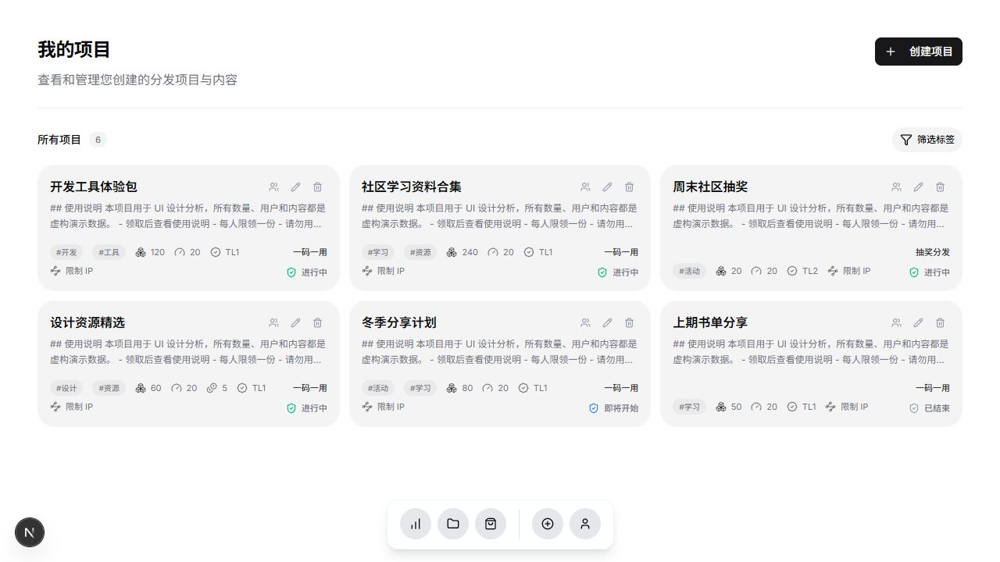
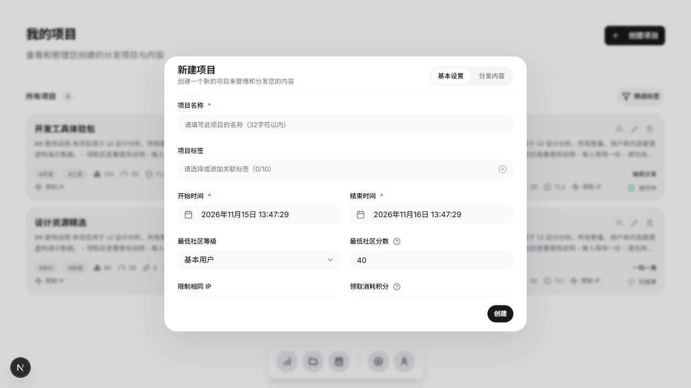
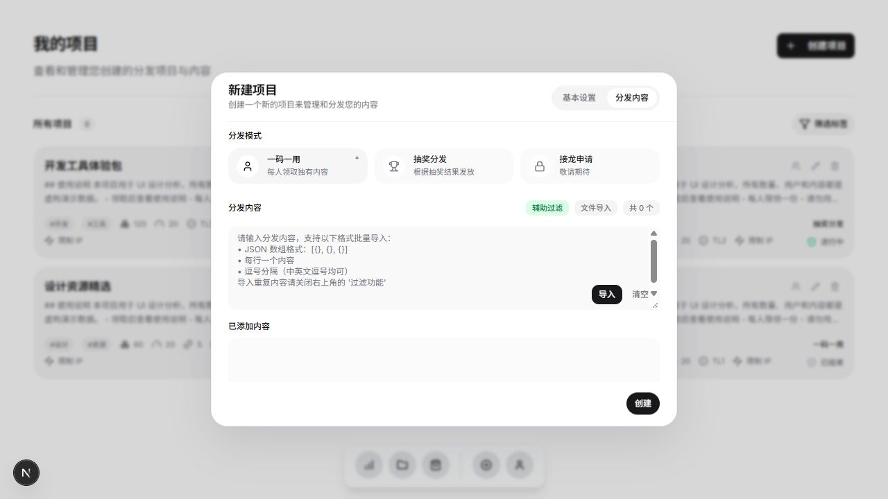

# CDK 项目管理：UI 设计分析

- 分析日期：2026-11-15。
- 来源：[linux-do/cdk](https://github.com/linux-do/cdk)，固定提交 `9e2bdc6548311ab902f341b3932eac93bde12deb`。
- 页面：`/project`，页面标题与主标题均为“我的项目”。
- 范围：项目列表、卡片、标签筛选、创建与编辑、批量导入、领取者列表和删除确认。结构与行为以源码为依据；运行预览采用演示数据，不能据此推断真实接口已联调成功。

图中展示进行中、即将开始、已结束三种时间状态。视口 1280×720；截图没有创建或修改真实项目。

## 1. 页面长什么样

主体是一张留白较多的项目管理页面。标题和创建入口放在顶部，下面用一条细分隔线进入管理区域；管理区域先放项目数量和筛选入口，再展示浅灰色大圆角卡片。它没有把每条数据做成密集表格，也没有在卡片上铺满彩色状态条。

| 从上到下 | 实际内容 | 视觉处理 |
|---|---|---|
| 标题区 | “我的项目”与创建按钮 | 标题 24px、粗体、紧字距；右侧操作保持独立，不被长标题挤走 |
| 说明 | “查看和管理您创建的分发项目与内容” | 次要灰色文字，帮助用户确认当前页面用途 |
| 分隔线 | 标题与内容之间的横线 | 浅色 `black/6`，深色 `white/6`，分区轻量 |
| 工具栏 | “所有项目”、总数、筛选标签 | 数量放在小胶囊里，筛选按钮使用灰底胶囊 |
| 已选条件 | 标签及单个移除 X、清除全部 | 仅有筛选时出现，可换行，条件始终可见 |
| 内容区 | 项目卡片网格 | 间距 12px；手机一列，中屏两列，大屏三列 |
| 分页 | 总数、当前页、上一页/下一页 | 仅多页时出现，每页 18 项，没有无限滚动 |

页面外层内容最大宽度为 `max-w-7xl`，水平内边距随屏幕从 16px 增至 48px。模块之间主要用 16–24px 间距。依据：[页面容器](https://github.com/linux-do/cdk/blob/9e2bdc6548311ab902f341b3932eac93bde12deb/frontend/app/%28main%29/layout.tsx#L14)、[标题与入口](https://github.com/linux-do/cdk/blob/9e2bdc6548311ab902f341b3932eac93bde12deb/frontend/components/common/project/ProjectMain.tsx#L232)、[工具栏与筛选条件](https://github.com/linux-do/cdk/blob/9e2bdc6548311ab902f341b3932eac93bde12deb/frontend/components/common/project/MineProject.tsx#L308)。

## 2. 单张卡片如何安排信息

卡片用 `22px` 圆角和 `bg-muted` 灰底，没有明显的默认边框。桌面内边距 16px，手机 14px；悬停时改变背景透明度，右上角操作从 70% 不透明度变为完全可见。卡片出现时有轻微位移、渐入和缩放，同一页按卡片序号错开 50ms。

| 位置 | 内容与规则 | 作用 |
|---|---|---|
| 左上 | 项目名，15–16px，最多两行 | 第一眼识别对象，长标题不无限撑高 |
| 右上 | 领取者、编辑、删除图标 | 管理操作集中，点击时阻止整卡跳转 |
| 中部 | 描述，11–12px，最多两行；为空显示“暂无描述” | 保留固定的描述高度，使卡片更整齐 |
| 左下 | 最多三个 `#标签`，多出的显示 `+N` | 保留分类线索，控制卡片密度 |
| 左下元信息 | 总内容数、风险值、价格、TL 等级、限制 IP | 通过小图标配数字或短文字展示；部分零值不展示 |
| 右下上行 | 一码一用 / 抽奖分发 / 邀请制 | 分发方式与数量分开，减少混读 |
| 右下下行 | 即将开始 / 进行中 / 已结束 | 状态图标分别为蓝、绿、灰，文字仍保留 |

整卡点击进入 `/receive/:id`。价格悬浮提示补充完整的两位小数和 `LDC` 单位；状态悬浮提示展示完整开始、结束时间。并非所有图标都有提示说明，标签 `+N` 也没有展开完整标签的专用浮层。

卡片状态由浏览器当前时间与开始、结束时间比较得出，数量展示的是 `total_items`。因此“进行中”和内容总数不能直接解释为“仍有库存、当前用户一定可以领取”。设计借鉴时，应保留这种字段含义上的区别。

依据：[卡片字段与状态计算](https://github.com/linux-do/cdk/blob/9e2bdc6548311ab902f341b3932eac93bde12deb/frontend/components/common/project/ProjectCard.tsx#L44)、[卡片布局](https://github.com/linux-do/cdk/blob/9e2bdc6548311ab902f341b3932eac93bde12deb/frontend/components/common/project/ProjectCard.tsx#L74)、[价格与时间提示](https://github.com/linux-do/cdk/blob/9e2bdc6548311ab902f341b3932eac93bde12deb/frontend/components/common/project/ProjectCard.tsx#L163)。

## 3. 标签筛选和翻页

“筛选标签”打开宽 320px 的 Popover，默认向按钮右端对齐。顶部是标题和清除操作，中部是搜索框，下面是最高 220px 的标签滚动区。标签选中后变灰底并出现勾号；底部再次列出已选择的标签，可直接点 X 移除。

- 搜索在已获取的标签数组中进行，不区分大小写；匹配结果超过一个时出现“全选”。
- 标签支持多选，每次更改都会回到第一页，并向列表接口提交标签组合。
- 弹层外仍保留“已筛选”标签行，用户关掉弹层后也能看出当前限制条件。
- 翻页时平滑滚动到顶部；第一页和最后一页分别禁用相应方向按钮。
- 未筛选列表有页面缓存；有标签筛选时重新请求，避免复用旧筛选结果。
- 用请求序号丢弃较旧响应，快速切换标签时避免旧结果盖掉新结果。

依据：[标签弹层](https://github.com/linux-do/cdk/blob/9e2bdc6548311ab902f341b3932eac93bde12deb/frontend/components/ui/tag-filter-popover.tsx#L40)、[请求与缓存](https://github.com/linux-do/cdk/blob/9e2bdc6548311ab902f341b3932eac93bde12deb/frontend/components/common/project/ProjectMain.tsx#L74)、[分页布局](https://github.com/linux-do/cdk/blob/9e2bdc6548311ab902f341b3932eac93bde12deb/frontend/components/common/project/MineProject.tsx#L250)。

## 4. 创建与编辑：一个弹窗分两个任务

截图保留了原始滚动布局：下方还有字段，底部“创建”操作区保持可见。

创建和编辑共用相近的居中弹窗视觉：24px 圆角、细淡边框、柔和阴影。标题与说明在左，胶囊 Tabs 在右；正文独立滚动，页脚保留右对齐的主要按钮。代码隐藏了右上角 X，因此操作时需要留意弹窗仍保留的键盘及遮罩关闭方式。

| 场景 | Tab 与内容 | 交互差异 |
|---|---|---|
| 创建 | 基本设置 / 分发内容 | 可选择分发模式，填写至少一条待分发内容 |
| 编辑普通项目 | 基本设置 / 追加内容 | 不提供分发模式切换；蓝色说明明确“追加”，展示现有数量 |
| 编辑抽奖项目 | 只有基本设置 | 不显示追加内容入口，不发送追加内容字段 |
| 创建成功 | 同一弹窗中的成功状态 | 展示可复制的领取链接及打开链接按钮 |
| 编辑成功 | 同一弹窗中的确认状态 | 显示绿色勾选，更新外层项目卡片 |

基本设置按“项目名称 → 标签 → 时间 → 社区门槛 → IP/价格 → Markdown 描述”排列。名称、标签和描述占整行，时间及门槛等成对字段在桌面两列、手机单列。名称最多 32 字符，标签最多 10 个且单个 16 字符，描述最多 1024 字符。

“最低社区分数”的显示值是 `100 - riskLevel`。首次出现时会自动打开帮助提示约 5 秒，再在本地记住已提示。它把较难理解的风控字段转成面向用户的“分数”，但卡片仍直接显示风险值，阅读时需要注意两者并不相同。

创建弹窗未成功关闭后，草稿会留在组件状态中；编辑弹窗每次打开会重新用项目数据初始化。两者的草稿保留策略不同。

依据：[创建弹窗及成功状态](https://github.com/linux-do/cdk/blob/9e2bdc6548311ab902f341b3932eac93bde12deb/frontend/components/common/project/CreateDialog.tsx#L258)、[编辑初始化](https://github.com/linux-do/cdk/blob/9e2bdc6548311ab902f341b3932eac93bde12deb/frontend/components/common/project/EditDialog.tsx#L75)、[编辑内容区](https://github.com/linux-do/cdk/blob/9e2bdc6548311ab902f341b3932eac93bde12deb/frontend/components/common/project/EditDialog.tsx#L238)、[基本字段](https://github.com/linux-do/cdk/blob/9e2bdc6548311ab902f341b3932eac93bde12deb/frontend/components/common/project/ProjectBasicForm.tsx#L104)。

### 分发模式决定后续内容

“分发内容”顶部是三张可选模式卡：图标、名称和简短说明。手机竖排，768px 起横排三列；选中态主要依赖灰底、图标白底和星号。

| 表单名称 | 对应内容 | 当前实现状态 |
|---|---|---|
| 一码一用 | 批量导入内容，可设置每次领取消耗积分 | 已有创建流程 |
| 抽奖分发 | 增加必填的 Linux Do 话题 ID，可从匹配格式的话题链接提取 ID | 已有创建流程；文案要求话题带抽奖标签且抽奖已经结束 |
| 接龙申请 | 展示“正在开发中” | 选项可以切换，但提交按钮禁用并显示“开发中” |

第三种模式在卡片名称常量中仍叫“邀请制”，与表单“接龙申请”不一致。不能把可见选项当成已经完成的功能。

仅“一码一用”允许付费；其他模式禁用价格输入并解释原因。聚焦价格输入或填写正金额时会检查支付配置，未配置、未启用或读取失败时展示说明，并提供“去设置”入口。0 表示免费，最多两位小数。

依据：[模式选择器](https://github.com/linux-do/cdk/blob/9e2bdc6548311ab902f341b3932eac93bde12deb/frontend/components/common/project/DistributionModeSelect.tsx#L13)、[动态分发区域](https://github.com/linux-do/cdk/blob/9e2bdc6548311ab902f341b3932eac93bde12deb/frontend/components/common/project/CreateDialog.tsx#L372)、[付费配置检查](https://github.com/linux-do/cdk/blob/9e2bdc6548311ab902f341b3932eac93bde12deb/frontend/components/common/project/ProjectBasicForm.tsx#L54)。

## 5. 批量导入的设计

导入区域分为“输入”和“待提交列表”两块，而不是让用户直接在一个无限增长的文本框中管理内容。

- 标题右侧放“辅助过滤”“文件导入”和数量 Badge；过滤默认开启，以绿色提示状态，悬浮说明具体行为。
- 文本输入框高 120px，“导入 / 清空”靠右下角；支持 JSON 数组、逐行文本、单行中英文逗号分隔。
- 下方使用 176px 高的滚动列表显示序号、内容和删除 X；编辑项目时标题为“待添加内容”。
- 没有内容时保留同样高度的灰底空状态，减少切换时的页面跳动。
- 开启过滤时，同时排除本批次中的重复内容及待提交列表中已存在的内容；Toast 告知导入数量和跳过数量，全重复则报错。
- 每条内容超过 1024 字符会截断。若把这种交互用于重要设备配置，建议改为明确提示截断，而不是无提示缩短输入。

文件导入另开弹窗，支持 `.txt`、`.jsonl`，最多 5MB，只处理所选的第一个文件。检测到二进制、非 ASCII 或非 Unicode 特征时会要求确认；正常中文文本也可能触发“非 ASCII”提示，这不是只有异常文件才会出现的确认。

依据：[批量导入组件](https://github.com/linux-do/cdk/blob/9e2bdc6548311ab902f341b3932eac93bde12deb/frontend/components/common/project/BulkImportSection.tsx#L97)、[解析与去重](https://github.com/linux-do/cdk/blob/9e2bdc6548311ab902f341b3932eac93bde12deb/frontend/components/common/project/constants.ts#L134)、[文件检查](https://github.com/linux-do/cdk/blob/9e2bdc6548311ab902f341b3932eac93bde12deb/frontend/hooks/use-file-upload.ts#L220)。

## 6. 领取者列表与删除确认

点击卡片右上角人物图标打开领取者弹窗。标题下说明当前项目，随后是“搜索用户名、昵称或内容...”输入框；下方固定 300px 高的结果区。每行展示用户名、昵称、等宽内容和复制按钮，保持紧凑而有序。

搜索等待 500ms 后再请求服务端，当前实现每次读取第一页、最多 100 条；弹窗没有继续翻页控件。复制会整理内容为多行，成功后图标变为绿色勾选两秒，并展示 Toast。这里分别处理了加载中、加载失败及重试、无领取者、搜索无匹配四类状态。

删除使用单独的 AlertDialog，写明项目名称和不可撤销后果，确认按钮为红色。提交过程中禁用取消和确认，阻止关闭；失败留在弹窗显示 Toast，成功后删除对应卡片并修正页数。

依据：[领取者搜索及状态](https://github.com/linux-do/cdk/blob/9e2bdc6548311ab902f341b3932eac93bde12deb/frontend/components/common/project/ReceiverDialog.tsx#L35)、[领取者弹窗布局](https://github.com/linux-do/cdk/blob/9e2bdc6548311ab902f341b3932eac93bde12deb/frontend/components/common/project/ReceiverDialog.tsx#L110)、[删除确认](https://github.com/linux-do/cdk/blob/9e2bdc6548311ab902f341b3932eac93bde12deb/frontend/components/common/project/MineProject.tsx#L376)。

## 7. 加载、错误和响应式

| 场景 | 实现表现 | 借鉴时的注意点 |
|---|---|---|
| 首次列表加载 | 18 个卡片骨架，模拟图标、标题、说明和标签位置 | 骨架与最终卡片保持同列数，避免布局跳动 |
| 真正无项目 | 文件夹图标、“暂无分发项目”、右上角创建指引 | 空状态说明下一步操作 |
| 筛选无结果 | 同一空状态，改为“未找到符合条件的分发项目”，可清除筛选 | 不要求用户逐个删除筛选标签 |
| 列表读取失败 | 当前与无项目共用“暂无分发项目”，未展示具体错误或重试按钮 | 应改为明确的错误态；领取者弹窗的失败设计更完整 |
| 表单校验失败 | Toast；内容或价格错误会切到对应 Tab | 目前没有逐字段错误提示，复杂表单可补字段定位 |
| 提交中 | 按钮禁用，显示“创建中 / 更新中” | 保留原弹窗上下文，减少重复提交 |

默认 Tailwind 断点下，列表在 768px 起两列、1024px 起三列；分页在手机先显示方向按钮，再显示统计。创建/编辑弹窗桌面最大宽 `max-w-2xl`、高 `78vh`，手机宽 `92vw`、高 `82vh`；内部正文独立滚动。领取者弹窗桌面最大宽 `max-w-3xl`，手机最大宽 `95vw`。

卡片管理图标只有 22–24px，元信息文字部分为 10–11px；整卡由可点击 `div` 实现，未声明键盘交互角色，图标按钮也缺少专门的可访问名称。若迁移到面向家长的手机界面，需要扩大点击区域、提高字号，并补足键盘和读屏支持。

依据：[骨架屏](https://github.com/linux-do/cdk/blob/9e2bdc6548311ab902f341b3932eac93bde12deb/frontend/components/common/project/ProjectMain.tsx#L15)、[列表空态与错误分支](https://github.com/linux-do/cdk/blob/9e2bdc6548311ab902f341b3932eac93bde12deb/frontend/components/common/project/MineProject.tsx#L170)、[表单校验](https://github.com/linux-do/cdk/blob/9e2bdc6548311ab902f341b3932eac93bde12deb/frontend/components/common/project/CreateDialog.tsx#L99)、[手机判断](https://github.com/linux-do/cdk/blob/9e2bdc6548311ab902f341b3932eac93bde12deb/frontend/hooks/use-mobile.ts#L3)。

## 8. 对当前手表项目的具体参考

| CDK 中的做法 | 可用于 JZClient 的位置 | 建议保留的设计原则 |
|---|---|---|
| 卡片先名称，再摘要和状态 | 多手表主页或设备列表 | 第一屏突出孩子/手表名称、电量、在线状态，完整时间放在详情中 |
| 操作图标集中，整卡进入详情 | 手表卡片、联系人、自动化规则 | 把查看与管理分开；手机操作区域扩大到约 44px |
| 筛选弹层 + 外部已选标签 | 多手表、多会话或插件列表 | 过滤入口可以折叠，但当前筛选条件保持可见 |
| 基本设置 / 内容设置两个 Tab | AI 助手、OneBot、定时日报配置 | 先填写使用者能理解的基础信息，再处理较复杂的规则 |
| 模式选择后只显示相关字段 | AI 触发方式、通知方式、设备模式 | 配置变化必须有清楚说明；未实现选项标明不可用 |
| 独立滚动的内容列表 | 批量联系人、链接库、定时规则 | 对数量、去重、待提交内容给出明确反馈 |
| 提交成功后留在原弹窗确认 | 绑定手表、保存设备设置 | 显示保存结果及下一步操作，减少用户对是否成功的疑问 |

这些模式可以通过当前项目已有的原生 DOM、CSS 变量和弹窗工具实现，不需要为了视觉相似就引入整套 React/Next.js。优先参考信息层级和反馈方式，再统一圆角、间距、按钮尺寸及状态颜色。
