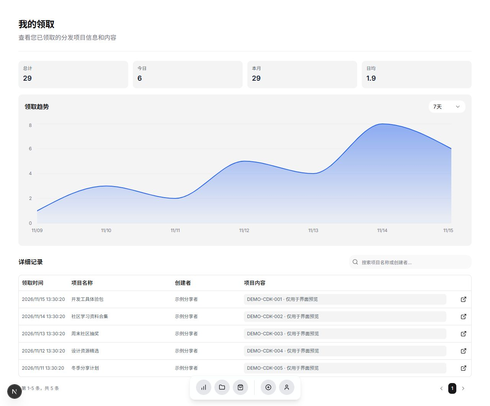

# CDK 领取记录：UI 设计分析

分析日期：2026-11-15。路由：`/received`，页面名称为「我的领取」。

来源：[linux-do/cdk](https://github.com/linux-do/cdk)，固定提交 `9e2bdc6548311ab902f341b3932eac93bde12deb`。本文结合源码与本地前端预览说明布局、组件和交互，演示记录不代表真实领取行为。



截图使用 1280px 桌面宽度并保存整页，呈现统计、图表、搜索、表格和分页之间的层次。

## 1. 页面长什么样

这是一个「先看趋势，再找记录」的历史页。上半部解释领取频率，下半部负责检索、查看和复制已领取内容。

```text
我的领取
页面说明
─────────────────────────────────────────────────────────
[总计]                [今日]                [本月]                [日均]

领取趋势                                  [最近7天 ▼]
[                    蓝色面积趋势图                     ]

详细记录                       [搜索项目名称或创建者…]
领取时间 | 项目名称 | 创建者 | 项目内容（复制） | 详情
……
当前条目范围 / 总数                       [上一页] [页码] [下一页]
```

页面使用纵向 `gap-6` 分隔内容，标题为 24px 粗体和紧字距。主结构见 [ReceivedMain.tsx:249](https://github.com/linux-do/cdk/blob/9e2bdc6548311ab902f341b3932eac93bde12deb/frontend/components/common/received/ReceivedMain.tsx#L249)。

## 2. 概要统计和趋势图

| 元素 | 视觉形式 | 行为 |
|---|---|---|
| 四项概要 | 浅灰 `bg-muted` 卡片、`rounded-lg` 圆角；12px 标签和 18px 数字 | 使用动态计数；小屏两列，`md` 起四列 |
| 时间范围 | 图表标题右侧的下拉选择 | 7 天、30 天、3 个月、6 个月，分别请求 7/30/90/180 天 |
| 趋势图 | 高 300px，蓝色 `#2563eb` 面积图，2px 曲线 | 只保留横向网格；悬停显示日期与领取次数 |
| 面积填充 | 蓝色渐变，透明度约 0.8 → 0.1 | 让领取次数变化形成明确的视觉轮廓 |

统计卡与图表见 [DataChart.tsx:167](https://github.com/linux-do/cdk/blob/9e2bdc6548311ab902f341b3932eac93bde12deb/frontend/components/common/received/DataChart.tsx#L167)。

这里的统计名称需要结合代码理解：

- 「总计」是当前图表接口返回范围的领取次数总和，并非用户完整历史总数。
- 「本月」只累加这次返回数据中的本月记录；选择 7 天时，它未必覆盖整个月。
- 「日均」把上述本月合计除以今天的日号，不是除以当前范围中实际有数据的天数。

统计口径见 [DataChart.tsx:110](https://github.com/linux-do/cdk/blob/9e2bdc6548311ab902f341b3932eac93bde12deb/frontend/components/common/received/DataChart.tsx#L110)。借鉴此布局时，建议把范围直接写进标签，或让统计接口单独提供完整月度数据。

## 3. 明细表的设计

| 列 | 展示和操作 |
|---|---|
| 领取时间 | 日期与时间，显示到秒 |
| 项目名称 | 长名称省略；点击后在新标签页打开 `/receive/:projectId` |
| 创建者 | 昵称优先，链接到 Linux Do 的用户主页 |
| 项目内容 | 等宽文字、浅灰内嵌底块、单行省略；悬停 title 保留完整内容 |
| 详情 | 使用外链图标进入项目领取页 |

列定义与空行见 [DataTable.tsx:215](https://github.com/linux-do/cdk/blob/9e2bdc6548311ab902f341b3932eac93bde12deb/frontend/components/common/received/DataTable.tsx#L215)。

内容既可以双击复制，也有单独复制按钮。桌面端按钮默认隐藏，悬停内容区域时出现，减少表格噪声；手机端按钮常驻，避免触屏用户找不到操作。相关实现见 [DataTable.tsx:263](https://github.com/linux-do/cdk/blob/9e2bdc6548311ab902f341b3932eac93bde12deb/frontend/components/common/received/DataTable.tsx#L263)。

它使用项目内的原生 `Table` 组件，**没有列排序，也没有 TanStack Table 的排序状态**。不能因为依赖列表中存在表格库，就推断这一页具备排序功能。

## 4. 搜索和分页

- 搜索框提示为「搜索项目名称或创建者...」，输入后等待 500ms，再向服务端请求。
- 改变搜索词会回到第 1 页。每页固定请求 20 条，没有每页条数选择器。
- 分页区展示当前条目范围与总条数；包含上一页、下一页和以当前页为中心的最多五个连续页码。
- 必要时补充第一页、最后一页和省略号。当前页采用主按钮样式，前后边界禁用对应方向按钮。
- 图表日期范围和明细搜索、页码分别管理，不是点击图中的某一天就筛选下方表格。

请求状态与防抖见 [ReceivedMain.tsx:154](https://github.com/linux-do/cdk/blob/9e2bdc6548311ab902f341b3932eac93bde12deb/frontend/components/common/received/ReceivedMain.tsx#L154)；分页渲染见 [DataTable.tsx:49](https://github.com/linux-do/cdk/blob/9e2bdc6548311ab902f341b3932eac93bde12deb/frontend/components/common/received/DataTable.tsx#L49)。

## 5. 手机适配和内容密度

概要卡片在小屏排列为两列，较宽时变为四列。复制按钮通过 `use-mobile` 的 768px 断点判断是否常驻。

详细记录仍保留五列表格，没有切换成手机记录卡片。列宽在 `lg/xl` 档位调整，外层允许横向滚动。因此它适合一次检索和复制明确的项目内容，但小屏浏览多字段时需要左右移动。

表格滚动容器见 [table.tsx:7](https://github.com/linux-do/cdk/blob/9e2bdc6548311ab902f341b3932eac93bde12deb/frontend/components/ui/table.tsx#L7)，手机断点见 [use-mobile.ts:3](https://github.com/linux-do/cdk/blob/9e2bdc6548311ab902f341b3932eac93bde12deb/frontend/hooks/use-mobile.ts#L3)。

## 6. 加载、空状态和错误提示

| 状态 | 实现中的表现 |
|---|---|
| 首次进入 | 图表和明细各自显示骨架屏，分别请求和结束加载，互不等待 |
| 无记录 | 表格跨五列显示 Package 图标、「暂无领取记录」和「您还没有领取任何项目内容」 |
| 搜索无结果 | 复用上述首次无记录文案，没有单独显示「未找到匹配项」 |
| 接口失败 | Sonner Toast 报错，关闭加载状态；没有固定在页面内的重试卡片 |
| 内容进入 | 淡入、向上 20px 归位，区域之间错峰出现 |

骨架屏外框使用 22px 圆角，加载完成的卡片和表格则使用 `rounded-lg/rounded-md`，两种状态的外形并非完全一致。独立加载结构见 [ReceivedMain.tsx:160](https://github.com/linux-do/cdk/blob/9e2bdc6548311ab902f341b3932eac93bde12deb/frontend/components/common/received/ReceivedMain.tsx#L160)。

## 7. 接口与组件分工

`ReceivedMain` 管理日期范围、搜索、页码及两个加载状态；`DataChart` 负责四项统计和趋势；`DataTable` 负责记录展示、复制、链接和分页。

图表调用 `GET /api/v1/projects/received/chart?day=7`；明细调用 `GET /api/v1/projects/received?current=1&size=20&search=`。两者均采用 `{ error_msg: "", data: ... }` 包装；明细中的 `data` 为 `{ total, results }`。接口定义见 [project.service.ts:146](https://github.com/linux-do/cdk/blob/9e2bdc6548311ab902f341b3932eac93bde12deb/frontend/lib/services/project/project.service.ts#L146)。

## 8. 对当前手表项目的设计参考

1. 健康历史、轨迹记录、应用使用记录可以采用「摘要 → 趋势 → 可检索明细」的结构。
2. 图表与明细独立加载，可以避免一个较慢的接口挡住整个页面。
3. 手机直接展示操作按钮，比依赖悬停更可靠；桌面可以保留悬停显现以控制密度。
4. 手表记录页的手机版本更适合将五列表格改成单条记录卡片，优先显示时间、关键数值和操作。
5. 统计标签应明确时间范围，并区分首次无记录、搜索无结果和请求失败，避免让家长误判数据状态。

[返回 CDK 界面总览](../UI设计参考/CDK-界面总览.md)
